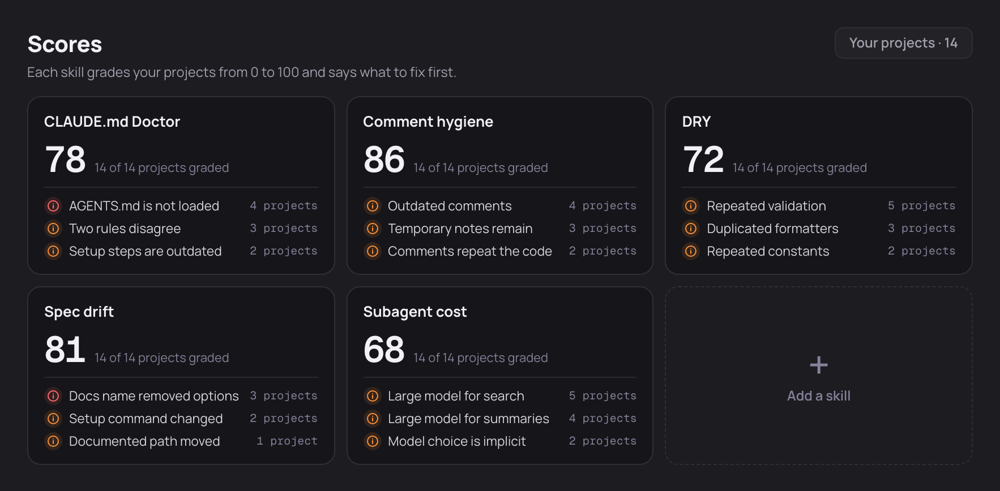
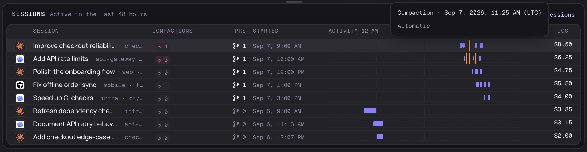

<div align="center">


# XTrace

**Know where your coding time and money go.**

An open-source macOS app for people who code with agents. See agent activity,
estimated human time and API-equivalent spend from the Claude Code, Codex and
Cursor history already on your Mac. Track Claude and Codex account usage and pace
in the sidebar.

[](https://github.com/XTraceAI/xtrace-desktop/releases/latest)
[](docs/SETUP.md)
[](LICENSE)
[](https://github.com/XTraceAI/xtrace-desktop/stargazers)

[**Download for Mac**](https://github.com/XTraceAI/xtrace-desktop/releases/latest) ·
[Setup guide](docs/SETUP.md) ·
[Report a bug](https://github.com/XTraceAI/xtrace-desktop/issues)


**See it in 44 seconds**

https://github.com/user-attachments/assets/a8e7619c-85a3-40d7-8a0b-50d9dc94f215

<sub>Screenshots and the video show the app with made-up sample projects and account usage, not real work.</sub>

</div>

## Why XTrace

You run several agents, try a new tool, or change how you prompt. XTrace helps you
see what changed in your time, spend and activity:

- **Where did my time go?** See agent activity alongside estimated human time,
  the ratio between them, and how many sessions ran at once.
- **What would this cost at API prices?** Explore spend by day and session,
  estimated from published API rates rather than your subscription bill.
- **What can I improve?** Run scoring skills on a project, read their findings,
  and add your own skills or ones you discover.
- **Will my usage last until the reset?** See account limits, whether you are
  ahead of or behind even use, and a forecast at your current pace.
- **What happened during a session?** Inspect activity spans, prompts and recorded
  context compactions on a timeline.

Use the daily charts and previous-period comparisons to investigate changes after
adopting a tool or workflow. Compare similar work and consider what you shipped
and the review it needed: more agent hours alone do not prove a productivity gain.

## Features

### Time, spend and parallel work

Compare estimated human time and agent activity together in the **human + agent**
view, or switch to agent hours, human hours or API-equivalent cost for the last
7, 14 or 30 days. The overview shows leverage (agent hours divided by estimated
human hours), concurrency and hands-off time, with previous-period comparisons.
Definitions explain how each number is counted and what is missing. Values the
app could not measure show as a dash, not zero.

### Scores: find what to improve

Use scoring skills to review your project instructions, comments, repeated code,
documentation and agent setup. Open a skill to grade a project and read its score,
findings and suggested fixes. The screenshot shows the built-in CLAUDE.md Doctor
alongside four example added skills.

<picture>
  <source media="(prefers-color-scheme: dark)" srcset="docs/images/readme/scores-dark.png">
  <source media="(prefers-color-scheme: light)" srcset="docs/images/readme/scores-light.png">
  
</picture>

_Sample scores and findings across 14 fictional projects, not measured grading results._

Add your own installed skills or discover skills through a public GitHub link.
A skill needs a scoring rubric; **Make a rubric** can create one for a suitable
review skill before you add it. Skills that need to modify a project or access
the network may not be suitable. See [adding skills and rubrics](docs/GRADING-RUBRIC.md).

Grading and rubric creation run Claude Code on your Claude account and use your
Claude usage. Grading reads project content and keeps the project read-only;
these are actions you start, separate from local history indexing. See
[Your data](#your-data) for what is sent and stored.

### Usage pace and forecasts

Claude and Codex usage stays in the sidebar when your local tools can report it.
Green and orange indicators show usage behind or ahead of an even pace. Expand a
provider to see remaining usage, daily readings and a linear forecast based on
average use since the weekly window began. The forecast assumes that pace
continues; it is an estimate, not a guaranteed run-out time.

### Session activity and compactions

See active spans and gaps across your sessions, then hover a span for its prompt
and activity details. Compaction counts show how often the saved context was
summarized. Counts cover the session's saved history; timeline markers show
recorded compaction times within the visible range. Hover a marker to see when it
happened and its trigger, when the source provides one. Unknown or unsupported
readings stay distinct from a confirmed zero.



The Sessions page brings your indexed Claude Code, Codex and Cursor sessions into
one list. Find a session by ID, repo or branch, filter by tool, and open its local
transcript. Codex and Cursor need the bundled readers and Python 3.10 or newer;
missing readers and unsupported formats show an unavailable state. Cursor SQLite
transcripts are not supported. A sub-session whose parent session can't be
confirmed is left out of the list.

### Pull requests and quick access

Merged pull requests show the effort of their linked sessions: tokens, your
messages, agent time and hands-off time. A session linked to several pull requests
counts in full toward each of them. Pull request details come from GitHub's
command-line tool (`gh`) when it is installed and signed in. XTrace never posts
to GitHub.

The menu bar keeps today's activity one click away. Settings includes light, dark
or system appearance, the human-time break threshold, index status,
storage controls and the telemetry switch.

## What the time numbers mean

**How is agent time counted?** XTrace groups recorded events within each session
into activity spans. Gaps longer than 20 minutes are excluded. Overlapping
sessions add together, so this measures session activity rather than pure model
compute time or elapsed time on a clock.

**How is human time estimated?** XTrace uses messages classified as sent by you,
excluding recognized automated messages, across conversations and tools on one
timeline. Consecutive messages at most 60 minutes apart count as one working
stretch. You can change that break threshold in Settings. A single isolated
message adds no time; an unknown message classification makes the estimate
unavailable rather than silently lowering it.

**Does reviewing diffs count?** Reviewing is not detected directly. If you send
messages at 2:00 and 2:40 and review in between, those 40 minutes count with the
default threshold. Review after your last message is not automatically included.
Other activity between those messages can count too, so this is an estimate of
your work with agents, not a record of every minute worked.

**Does this identify who edited a file?** No. Agent time measures recorded agent
activity, and human time uses message timing. They can overlap. These metrics do
not attribute individual edits or lines to you or an agent.

## Install

1. Download the `.dmg` from the [latest release](https://github.com/XTraceAI/xtrace-desktop/releases/latest).
2. Drag **XTrace** into **Applications**.
3. Open it. The first scan reads your existing history and shows its progress.

Requires an Apple Silicon Mac with macOS 14 or newer. Claude Code history is read
directly; Codex and Cursor history needs Python 3.10 or newer. Cursor
conversations kept only in the Cursor app's own database are not read. The app
downloads signed updates and installs them when you click **Restart to update**.
See the [setup guide](docs/SETUP.md) for first launch and troubleshooting.

## Your data

- **Local history indexing.** XTrace reads the history files your agents already
  save without editing them or automatically uploading their transcripts.
- **Metrics, not full transcripts.** By default the local database keeps metrics,
  repository paths, IDs and a preview (up to 280 characters) of each message you
  sent and of each recognized Claude Code background-task summary. Previews can't
  be turned off. Full transcripts are saved only if you turn that on. Settings
  can delete saved text; anything imported afterwards, including older messages,
  gets new previews.
- **Scoring uses Claude.** When you start a grade, Claude Code reads the selected
  project and skill; that content can be sent to Claude on your account. Making a
  rubric similarly uses the selected skill's content. Grading keeps the project
  read-only and blocks network access for sandboxed commands; that does not make
  Claude's model requests offline. The run's transcript is not saved by Claude
  Code; XTrace keeps the resulting scores, summaries, findings and reports. See
  [grading and rubric details](docs/GRADING-RUBRIC.md).
- **Other network use.** XTrace uses the network for anonymous usage telemetry
  (see [Telemetry](#telemetry)), account usage readings, GitHub pull request checks,
  app updates, and public GitHub look-ups and downloads you start with **Add from
  a link**. Keeping a skill stores it locally and links it into normal Claude Code
  sessions when its name is free there. Claude usage checks run your local Claude
  Code about every ten minutes, which adds small entries to Claude Code's own
  settings and history.

More about local storage and account-usage checks is in
[data and network](docs/SETUP.md#data-and-network).

## Telemetry

XTrace sends a few anonymous usage events, such as when the app is opened
and roughly how often it is used, with the app version, the macOS version, which
coding agents have history on this Mac and a random ID. It never sends repository
names, file paths, prompts or other conversation text, pull-request links, token
counts or costs. Telemetry is on by default, and nothing is sent until the app has
shown a notice about it. Turn it off with **Turn off** in that notice, the switch in
Settings, or by starting the app with `XTRACE_TELEMETRY=0`. [TELEMETRY.md](TELEMETRY.md)
lists every event and property.

## Status

XTrace is a public beta. Some numbers can be incomplete when part of your
history is missing. Rulebook and Leaderboard are marked as coming soon in the sidebar. See the [beta testing limits](docs/UPDATES.md#beta-testing-limits).

## Build from source

You need macOS 14 or newer, Xcode command-line tools, Rust 1.94.1, Node 22.23.1
and pnpm 10.33.0.

```sh
pnpm install --frozen-lockfile
pnpm check
cargo test --workspace --locked
pnpm tauri dev
```

A development build reads your local history by default. [DEVELOPING.md](DEVELOPING.md)
covers sample data, all required checks and native verification, and the
[architecture map](docs/ARCHITECTURE.md) explains how the pieces fit together.

## Contributing

Issues and pull requests are welcome. Read the [contributor guide](CONTRIBUTING.md)
for review and DCO sign-off, and the [code of conduct](CODE_OF_CONDUCT.md).
Security reports go through [SECURITY.md](SECURITY.md).

## License

Source code is licensed under [Apache-2.0](LICENSE). The XTrace name and logo are
covered by the [trademark terms](TRADEMARKS.md).
