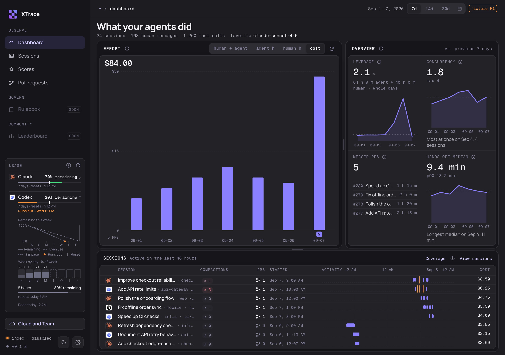

<div align="center">


# XTrace Desktop

**See what your coding agents actually did.**

Agent hours, API-equivalent cost, parallel sessions and merged pull requests,
read from the Claude Code, Codex and Cursor history already on your Mac.

[](https://github.com/XTraceAI/xtrace-desktop/releases/latest)
[](docs/SETUP.md)
[](LICENSE)
[](https://github.com/XTraceAI/xtrace-desktop/stargazers)

[**Download for Mac**](https://github.com/XTraceAI/xtrace-desktop/releases/latest) ·
[Setup guide](docs/SETUP.md) ·
[Report a bug](https://github.com/XTraceAI/xtrace-desktop/issues)



<sub>The screenshot uses made-up sample projects, not real work.</sub>

</div>

## Why XTrace

You run three agents at once, switch between Claude Code and Codex, and by Friday
you can't say where the week went. The history to answer that is already on your
Mac, spread across many transcript files. XTrace reads it and answers:

- **How much did my agents work, and how much did I?** Agent hours next to an
  estimate of your own time, based on when you sent messages, and the ratio
  between them.
- **What would this cost at API prices?** Per session and per day, estimated from
  published API rates (not your subscription bill).
- **Is it shipping?** Which merged pull requests your sessions are linked to, and
  the agent time of those linked sessions.
- **Am I about to hit a limit?** Claude and Codex account usage, right in the sidebar.

## Features

### Dashboard

Daily agent hours and cost, leverage, concurrency, hands-off time and merged pull
requests for the last 7, 14 or 30 days. Definitions explain how each number is
counted and what is missing. Values the app could not measure show as a dash, not
zero.

### Sessions

Your indexed Claude Code, Codex and Cursor sessions in one list. Find a session
by ID, repo or branch, filter by tool, open it to see its timeline, and read
Claude, Codex and Cursor JSONL transcripts from their original local sources.
Codex and Cursor need the bundled readers and Python 3.10 or newer; missing
readers and unsupported formats show an unavailable state. Cursor SQLite
transcripts are not supported. A sub-session whose parent session can't be
confirmed is left out of the list.

### Pull requests

Merged pull requests with the effort of their linked sessions: tokens, your
messages, agent time and hands-off time. A session linked to several pull requests
counts in full toward each of them. Pull request details come from GitHub's
command-line tool (`gh`) when it is installed and signed in. XTrace never posts
to GitHub.

### Menu bar, usage and more

- **Menu bar:** today's activity one click away.
- **Usage:** Claude and Codex account limits, where your local tools can report them.
- **Rulebook:** recorded activity from your local agent rules.
- **Settings:** light, dark or system appearance, index status, storage
  controls and the telemetry switch.

## Install

1. Download the `.dmg` from the [latest release](https://github.com/XTraceAI/xtrace-desktop/releases/latest).
2. Drag **XTrace** into **Applications**.
3. Open it. The first scan reads your existing history and shows its progress.

Requires an Apple Silicon Mac with macOS 14 or newer. Claude Code history is read
directly; Codex and Cursor history needs Python 3.10 or newer. Cursor
conversations kept only in the Cursor app's own database are not read. The app
downloads signed updates and installs them when you click **Restart to update**.
See the [setup guide](docs/SETUP.md) for first launch and troubleshooting.

## Your data

- **Reads your history, no transcript upload.** XTrace reads the history files
  your agents already save and does not edit them. There is no cloud transcript
  upload.
- **Metrics, not full transcripts.** By default the local database keeps metrics,
  repository paths, IDs and a preview (up to 280 characters) of each message you
  sent and of each recognized Claude Code background-task summary. Previews can't
  be turned off. Full transcripts are saved only if you turn that on. Settings
  can delete saved text; anything imported afterwards, including older messages,
  gets new previews.
- **Network use is limited.** The app contacts the network only for anonymous
  usage telemetry (see [Telemetry](#telemetry)), account usage readings, GitHub
  pull request checks, app updates, and GitHub look-ups you start with "Add from
  a link" when adding a skill. Claude usage checks run your local Claude
  Code about every ten minutes, which adds small entries to Claude Code's own
  settings and history.

The full details are in [data and network](docs/SETUP.md#data-and-network).

## Telemetry

XTrace Desktop sends a few anonymous usage events, such as when the app is opened
and roughly how often it is used, with the app version, the macOS version, which
coding agents have history on this Mac and a random ID. It never sends repository
names, file paths, prompts or other conversation text, pull-request links, token
counts or costs. Telemetry is on by default, and nothing is sent until the app has
shown a notice about it. Turn it off with **Turn off** in that notice, the switch in
Settings, or by starting the app with `XTRACE_TELEMETRY=0`. [TELEMETRY.md](TELEMETRY.md)
lists every event and property.

## Status

XTrace Desktop is a public beta. Some numbers can be incomplete when part of your
history is missing. Leaderboard and rule editing are not built yet. See the [beta testing limits](docs/UPDATES.md#beta-testing-limits).

## Build from source

You need macOS 14 or newer, Xcode command-line tools, Rust 1.94.1, Node 22.23.1
and pnpm 10.33.0.

```sh
pnpm install --frozen-lockfile
pnpm check
cargo test --workspace --locked
pnpm tauri dev
```

A development build reads your local history by default. [DEVELOPING.md](DEVELOPING.md)
covers sample data, all required checks and native verification, and the
[architecture map](docs/ARCHITECTURE.md) explains how the pieces fit together.

## Contributing

Issues and pull requests are welcome. Read the [contributor guide](CONTRIBUTING.md)
for review and DCO sign-off, and the [code of conduct](CODE_OF_CONDUCT.md).
Security reports go through [SECURITY.md](SECURITY.md).

## License

Source code is licensed under [Apache-2.0](LICENSE). The XTrace name and logo are
covered by the [trademark terms](TRADEMARKS.md).
